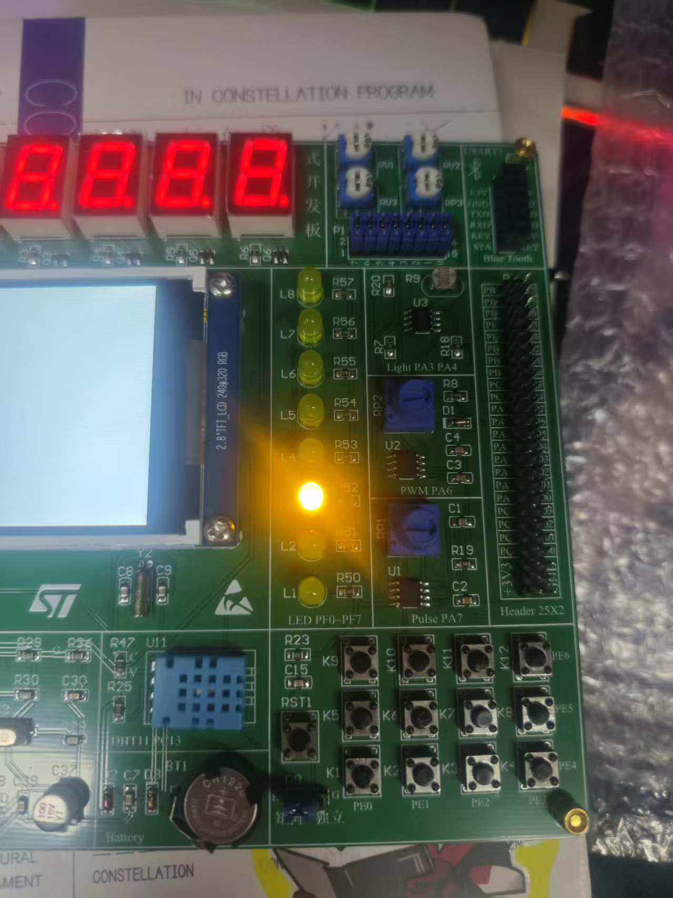
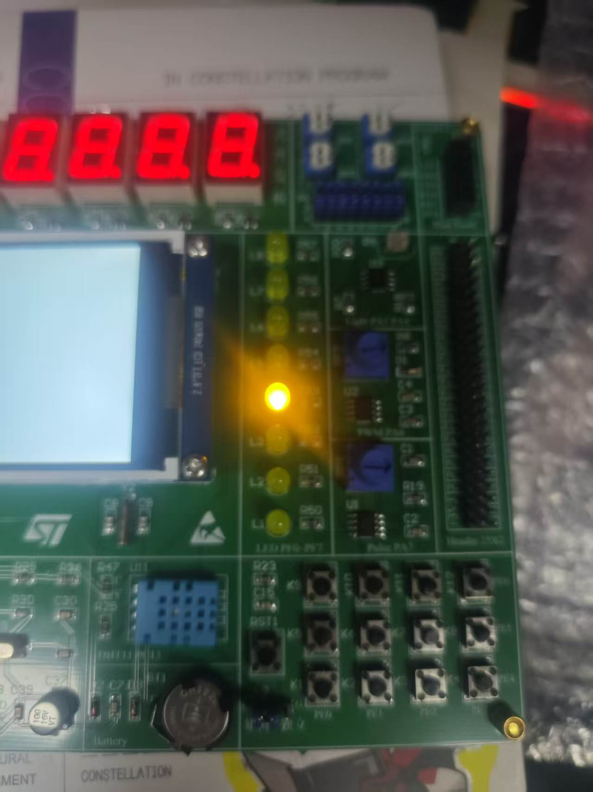
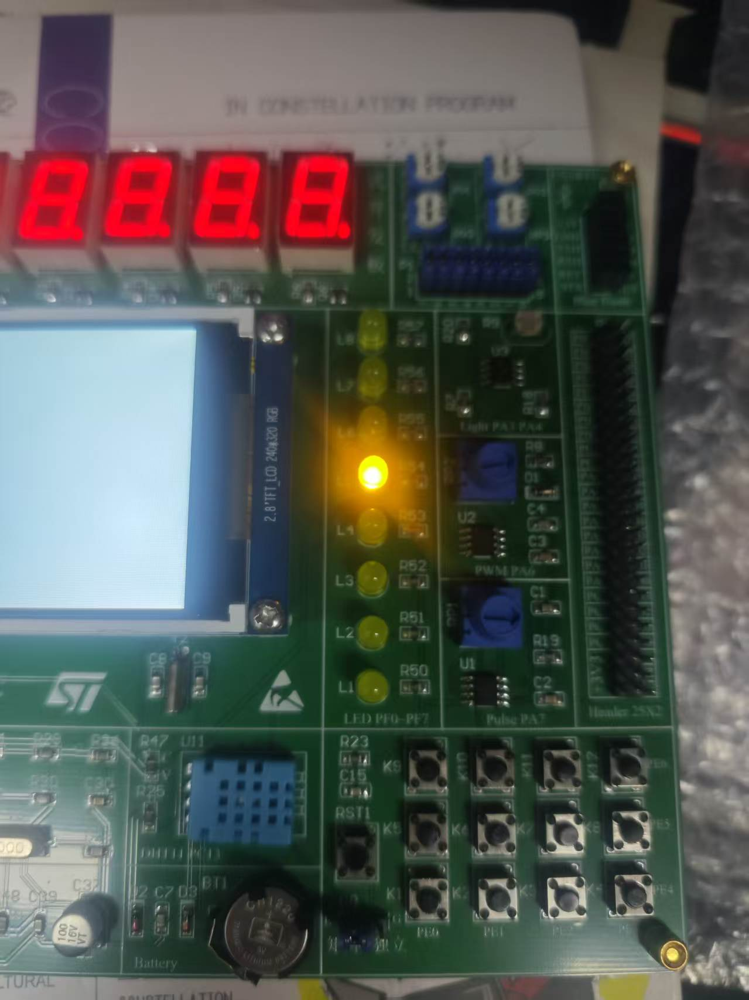

# 实验一：LED 流水灯（Keil5 优化版）

| 项目 | 内容 |
| --- | --- |
| 实验名称 | LED 流水灯 —— BSRR 原子操作 + 表驱动花样引擎 |
| 姓名 / 学号 | 汪传贵 / 2411020054 |
| 班级 | 24 电信 1 班 |
| 开发板 | STM32F407ZETX |
| 开发工具 | Keil MDK 5（ARM Compiler 6），工程文件 `MDK-ARM/0501_LEDWater.uvprojx`；原 STM32CubeIDE 工程同样保留可用 |
| 主频 | 168 MHz（HSI 经 PLL 倍频） |

## 一、实验目的

1. 掌握 STM32 GPIO 输出模式的配置方法；
2. 理解 `ODR` 与 `BSRR` 两种输出方式的区别，掌握用 `BSRR` 做原子位操作；
3. 掌握基于 `HAL_GetTick()` 的时间片调度写法，写出不阻塞主循环的任务；
4. 用"帧表 + 节拍"的表驱动方式实现多种流水灯花样，并能在 Keil5 中建立、编译、下载工程；
5. 用 8 个 LED 实现连续流动的流水灯效果。

## 二、实验原理

### 1. 硬件连接

8 个 LED 接在 **PF0～PF7**（丝印 L1～L8），**低电平点亮**（输出低电平 → 灯亮，输出高电平 → 灯灭）。

### 2. 为什么用 BSRR 而不是 ODR

| 方式 | 写法 | 特点 |
| --- | --- | --- |
| `ODR` | `GPIOF->ODR = ~(1 << i)` | 整端口**覆盖**写入，PF8～PF15 也被一起改写 |
| `BSRR` | `GPIOF->BSRR = ...` | 位**原子**置位/复位，只影响写 1 的那几位 |

`BSRR` 低 16 位写 1 表示"输出高电平"（灯灭），高 16 位写 1 表示"输出低电平"（灯亮）。
因此"点亮一些灯、熄灭另一些灯"可以**一次写完成**：

```c
uint16_t lit = (uint16_t)(lit_mask & LED_MASK);   /* 要亮的灯 */
uint16_t off = (uint16_t)(~lit & LED_MASK);       /* 要灭的灯 */

LED_PORT->BSRR = ((uint32_t)lit << 16) | (uint32_t)off;
```

这样不会出现"先全灭、再点亮"的中间态，肉眼看不到闪一下；而且只碰 PF0～PF7。

### 3. 表驱动花样引擎（本次优化的核心）

把每一种花样写成一张 **帧表**（每个字节就是 8 颗灯的状态，bit0 对 LED1），再加一个节拍时间：

```c
static const uint8_t s_fx_single_run[] = {0x01,0x02,0x04,0x08,0x10,0x20,0x40,0x80};
static const uint8_t s_fx_pingpong[]   = {0x01,0x02,0x04,0x08,0x10,0x20,0x40,0x80,
                                          0x40,0x20,0x10,0x08,0x04,0x02};
static const uint8_t s_fx_accumulate[] = {0x01,0x03,0x07,0x0F,0x1F,0x3F,0x7F,0xFF};
static const uint8_t s_fx_alternate[]  = {0xAA,0x55};
```

| 花样 | 节拍 | 现象 |
| --- | --- | --- |
| 单向流水（默认） | 250 ms | 一颗灯从 L1 移到 L8，循环 |
| 往复流水 | 200 ms | L1 ↔ L8 来回扫描 |
| 逐位累积 | 180 ms | 一颗颗累加到全亮，再重新开始 |
| 奇偶交替 | 400 ms | 1357 / 2468 两组灯交替闪 |

每种花样循环 2 遍后自动切换到下一种。想加一种花样，只需要"加一个数组 + 枚举加一项 + 表里加一行"。

### 4. 非阻塞时间片

用 `HAL_GetTick()`（SysTick 中断累加的毫秒计数）判断是否到了下一帧：

- 没到时间：直接返回，**主循环不会被卡住**；
- 到了时间：输出下一帧，游标后移；
- 时刻用"上一次时刻 + 节拍"递推，而不是直接取 `now`，这样每帧的微小误差不会累积。

## 三、实验步骤

1. 用 STM32CubeMX 生成 STM32F407ZETX 工程（时钟树 168 MHz，PF0～PF7 推挽输出、默认高电平）；
2. 用 CubeMX 的 "MDK-ARM" 工具链生成 Keil 工程框架，补上启动文件，得到 `MDK-ARM/0501_LEDWater.uvprojx`；
3. 新建 `bsp_led.c/h`（LED 底层驱动）和 `led_effect.c/h`（花样引擎）；
4. 在 `main.c` 的 `while(1)` 中周期调用 `LedEffect_Task()`；
5. 用 Keil5 打开工程 → Options for Target → Debug 选 **ST-Link**、Port 选 **SW** → `F7` 编译 → `F8` 下载；
6. 复位运行，观察 8 个 LED 的流水效果。

## 四、程序结构

| 文件 | 作用 |
| --- | --- |
| `Core/Src/main.c` | 初始化 + 主循环，只负责调用花样任务 |
| `Core/Src/bsp_led.c` | LED 底层驱动：`LED_Write()` 一次 BSRR 写完 8 颗灯 |
| `Core/Inc/bsp_led.h` | 硬件参数宏（端口、起始引脚、数量、极性、掩码） |
| `Core/Src/led_effect.c` | 花样引擎：帧表、节拍、帧游标、自动轮播 |
| `Core/Inc/led_effect.h` | 花样序号枚举 + 三个可配置宏 |
| `Core/Src/gpio.c` | 引脚初始化（PF0～PF7 推挽输出） |
| `MDK-ARM/` | Keil5 工程（`.uvprojx` + ARM 启动文件 + 工程说明） |

主循环非常干净，后续要加按键、串口等功能，直接往下加任务即可：

```c
while (1)
{
  LedEffect_Task();      /* 非阻塞：没到节拍立即返回 */
  /* 以后可以在这里加别的任务 */
}
```

## 五、关键代码

### 1. 一次 BSRR 写完 8 颗灯

```c
void LED_Write(uint16_t lit_mask)
{
  uint16_t lit = (uint16_t)(lit_mask & LED_MASK);   /* 要亮的灯 */
  uint16_t off = (uint16_t)(~lit & LED_MASK);       /* 要灭的灯 */

  /* 低电平点亮：点亮的灯写复位位(高 16 位)，熄灭的灯写置位位(低 16 位) */
  LED_PORT->BSRR = ((uint32_t)lit << 16) | (uint32_t)off;
}
```

### 2. 帧表 + 节拍表

```c
typedef struct
{
  const uint8_t *frames;       /* 帧表：每一项是 8 颗灯的图案 */
  uint8_t        frame_num;    /* 帧数 */
  uint16_t       interval_ms;  /* 每帧停留时间 */
} LedFxDef_t;

static const LedFxDef_t s_fx_table[LED_FX_COUNT] =
{
  { s_fx_single_run, FX_FRAME_NUM(s_fx_single_run), 250U },
  { s_fx_pingpong,   FX_FRAME_NUM(s_fx_pingpong),   200U },
  { s_fx_accumulate, FX_FRAME_NUM(s_fx_accumulate), 180U },
  { s_fx_alternate,  FX_FRAME_NUM(s_fx_alternate),  400U }
};
```

> `FX_FRAME_NUM()` 用 `sizeof` 在编译期算出帧数，增删帧不用改任何数字。

### 3. 非阻塞任务

```c
void LedEffect_Task(void)
{
  const LedFxDef_t *def = &s_fx_table[s_cur_fx];
  uint32_t now = HAL_GetTick();

  if ((uint32_t)(now - s_last_ms) < (uint32_t)def->interval_ms)
  {
    return;                       /* 还没到下一帧，立即返回 */
  }

  s_last_ms += def->interval_ms;  /* 用"上次时刻+节拍"递推，消除误差累积 */

  if ((uint32_t)(now - s_last_ms) > 1000U)
  {
    s_last_ms = now;              /* 被长时间打断（如断点）则重新对齐 */
  }

  LED_Write(def->frames[s_frame]);

  if (++s_frame >= def->frame_num)
  {
    s_frame = 0U;
    if (++s_cycle >= LED_FX_DWELL_CYCLES)
    {
      LedEffect_Load((uint8_t)((s_cur_fx + 1U) % (uint8_t)LED_FX_COUNT));
    }
  }
}
```

## 六、实验结果

上电后 8 个灯依次点亮，依次播放单向流水、往复流水、逐位累积、奇偶交替四种花样，
每种循环 2 遍后切换到下一种，循环往复。由于全程非阻塞，主循环的 CPU 占用极低。





想固定成经典的单向流水：把 `led_effect.h` 里的 `LED_FX_AUTO_CYCLE` 改成 `0`。

## 七、与原实现的对比

| 对比项 | 原实现 | 现实现 | 改进点 |
| --- | --- | --- | --- |
| 输出方式 | `GPIOF->ODR = ~(1<<i)` 整端口覆盖 | `GPIOF->BSRR` 原子位操作 | 不误伤 PF8～PF15，无中间态闪烁 |
| 延时方式 | `delay(24000000)` 空循环 | `HAL_GetTick()` 时间片 | 不受编译优化等级/主频影响，且不阻塞 |
| 任务结构 | 主循环里 for + 阻塞延时 | `LedEffect_Task()` 非阻塞任务 | 主循环可以继续加其他任务 |
| 花样扩展 | 8 次移位写死在 main.c | 帧表 + 节拍表 | 加花样只加数组和表项，不改逻辑 |
| 硬件适配 | 端口/引脚/极性散落在代码里 | `bsp_led.h` 顶部 4 个宏 | 换板子只改宏定义 |
| 工程 | 仅 STM32CubeIDE | 增加 Keil5 工程 | 两套 IDE 都能直接编译 |

## 八、说明与注意点

- **低电平点亮**：`BSRR` 用高 16 位（复位位）点亮、低 16 位置位熄灭，写反了现象就是"该亮的灭、该灭的亮"；
- **`LED_MASK` 限定在 0x00FF**：只操作 PF0～PF7，同端口其他引脚不会被改；若板子是高电平点亮，把 `LED_ACTIVE_LOW` 改成 `0` 即可，其余代码不用动；
- 时间片是"软定时"，`HAL_GetTick()` 由 SysTick 中断驱动，中断被长时间关闭时会有累积误差，需要更精确的节拍可以改成 TIM 定时器中断；
- Keil 工程里的启动文件 `MDK-ARM/startup_stm32f407zetx.s` 是 **ARM 汇编**版本，不要和 `Startup/` 下给 GCC 用的同名文件互换。

## 九、文件说明

| 路径 | 内容 |
| --- | --- |
| `Core/Src/main.c` | 主程序：时钟配置、初始化、主循环 |
| `Core/Src/bsp_led.c` | LED 驱动（BSRR 原子写、单灯操作） |
| `Core/Inc/bsp_led.h` | LED 硬件参数与接口声明 |
| `Core/Src/led_effect.c` | 花样引擎（帧表、节拍、自动轮播） |
| `Core/Inc/led_effect.h` | 花样枚举与可配置宏 |
| `Core/Src/gpio.c` | GPIO 初始化（PF0～PF7 推挽输出） |
| `MDK-ARM/` | Keil5 工程：`0501_LEDWater.uvprojx`、ARM 启动文件、工程说明 |
| `Drivers/` | CMSIS + STM32F4xx HAL 驱动库 |
| `Startup/` | GCC 启动文件 `startup_stm32f407zetx.s`（CubeIDE 用） |
| `docs/` | 早期时序图及生成脚本 |
| `screenshots/` | 现象截图 |
| `0501_LEDWater.ioc` | CubeMX 工程配置文件 |
