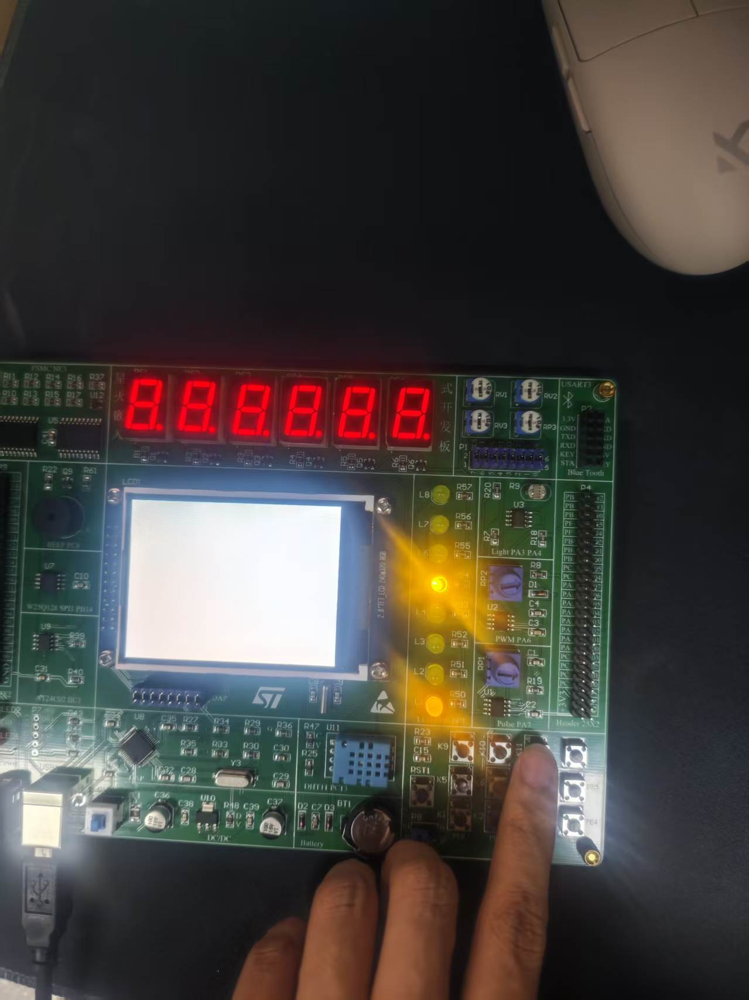
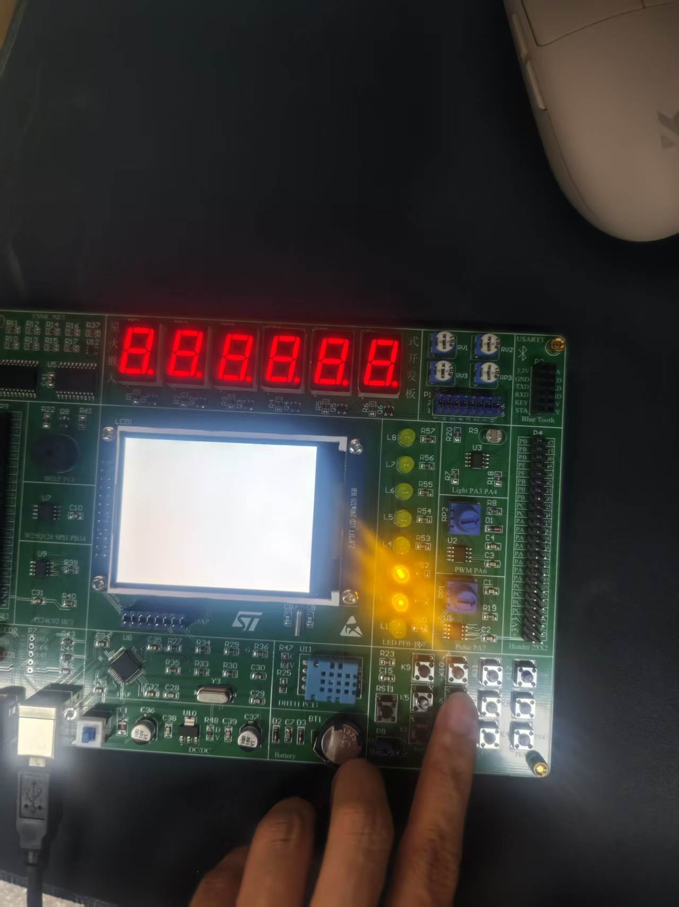
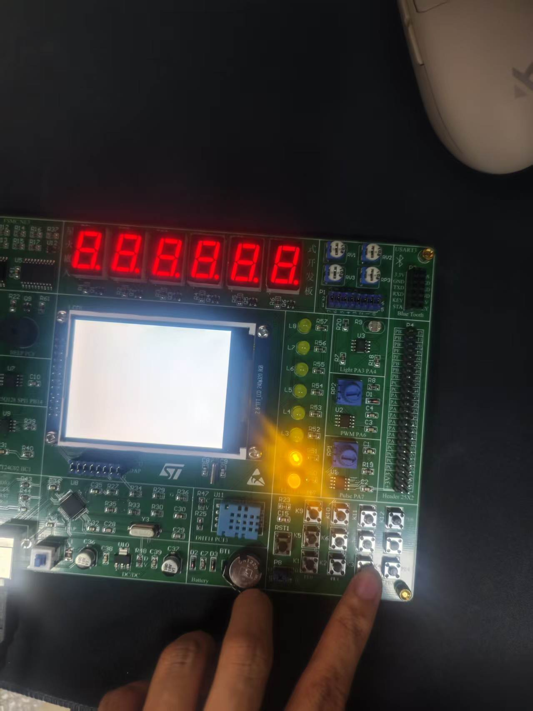
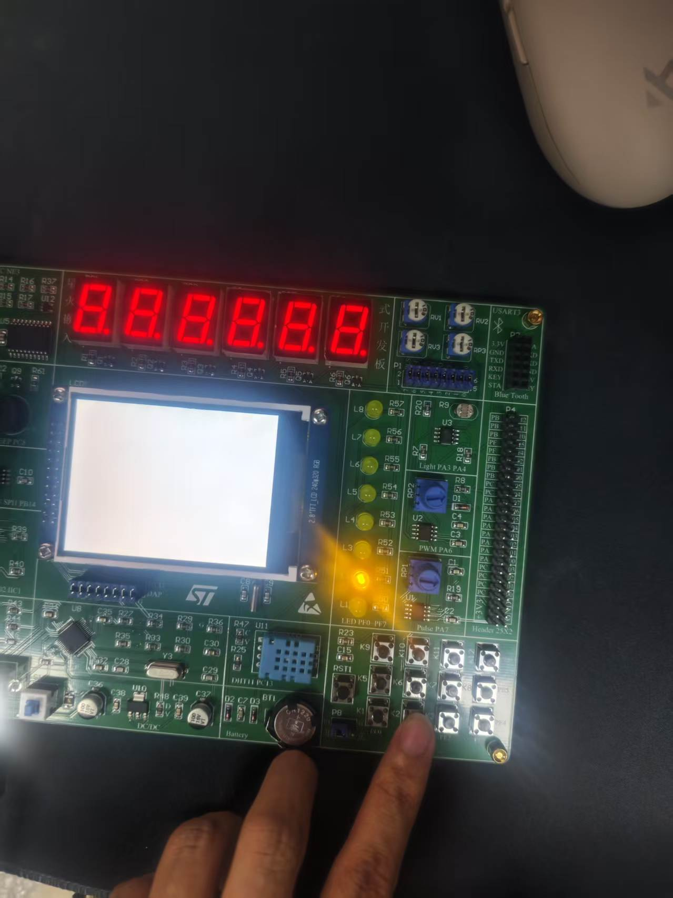
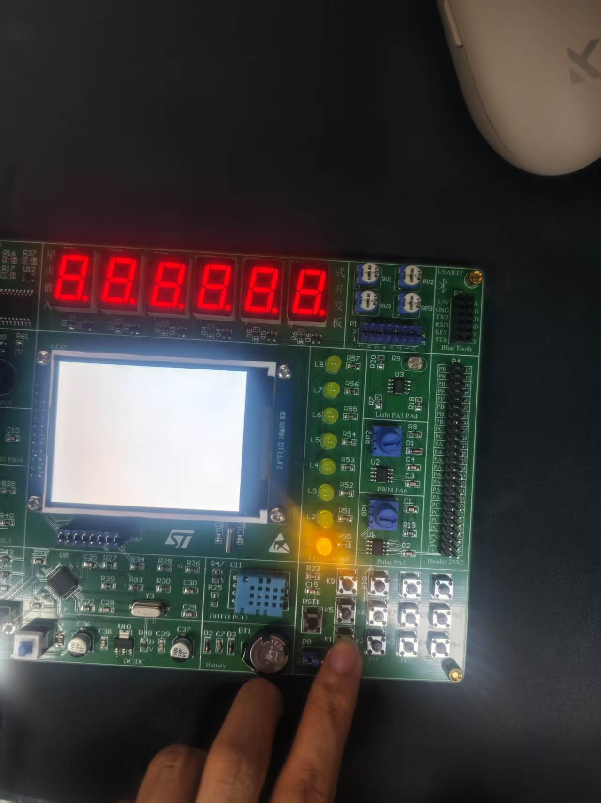

# 实验二：3×4 矩阵键盘

| 项目 | 内容 |
| --- | --- |
| 实验名称 | 3×4 矩阵键盘扫描 |
| 姓名 / 学号 | 汪传贵 / 2411020054 |
| 班级 | 24 电信 1 班 |
| 开发板 | STM32F407ZETX |
| 开发工具 | STM32CubeIDE |

## 一、实验目的

1. 掌握矩阵键盘的行扫描、列读取原理；
2. 掌握用寄存器直接读写 `IDR` / `ODR` 控制 GPIO 的方法；
3. 实现按键消抖与键值编码，并把键值用 LED 以 8421BCD 码显示出来。

## 二、实验原理

硬件连接：

| 端口 | 方向 | 功能 |
| --- | --- | --- |
| PE0～PE3 | 输入（上拉） | 4 根列线 COL0～COL3 |
| PE4～PE6 | 输出 | 3 根行线 ROW0～ROW2 |
| PF0～PF3 | 输出 | 键值个位（8421BCD） |
| PF4～PF7 | 输出 | 键值十位（8421BCD） |

扫描流程（`main.c` 主循环）：

1. 读取列线 `GPIOE->IDR & 0x0F`，若不全为高（`!= 0x0F`）说明有键按下；
2. `HAL_Delay(16)` 软件消抖，再读一次确认；
3. 根据哪一列为低确定列号：`0x0E`→1、`0x0D`→2、`0x0B`→3、`0x07`→4；
4. 键值 = 4 × 行号 + 列号，即 1～12；
5. 扫描下一行前，把第 `i` 行输出低电平：`GPIOE->ODR = ~(1 << (i + 4))`；
6. 键值按 8421BCD 送到 LED：`GPIOF->ODR = ~((KeyVal/10 << 4) + KeyVal%10)`（LED 低电平点亮）。

`PreLine[3] = {2, 0, 1}` 用来修正循环变量与物理行号的对应关系（按实际接线顺序）。

## 三、实验步骤

1. 配置 PE0～PE3 为上拉输入、PE4～PE6 为推挽输出、PF0～PF7 为推挽输出；
2. 在 `while(1)` 中按行循环拉低行线，读取列线判断按键；
3. 加入 16 ms 消抖，计算键值；
4. 将键值转成 BCD 码从 PF 口输出，用 LED 观察；
5. 逐个按下 12 个按键，核对显示的键值。

## 四、关键代码

```c
for (i = 0; i < 3; i++)
{
  /* 读取列线 PE0~PE3，不全为高说明有键按下 */
  if ((GPIOE->IDR & 0x0F) != 0x0F)
  {
    HAL_Delay(16);                         /* 软件消抖 16ms */
    if ((GPIOE->IDR & 0x0F) != 0x0F)       /* 复测仍按下，确认为有效按键 */
    {
      switch (GPIOE->IDR & 0x0F)           /* 哪一列为低，就是哪一列被按下 */
      {
        case 0x0E: KeyVal = 4 * PreLine[i] + 1; break;
        case 0x0D: KeyVal = 4 * PreLine[i] + 2; break;
        case 0x0B: KeyVal = 4 * PreLine[i] + 3; break;
        case 0x07: KeyVal = 4 * PreLine[i] + 4; break;
        default  : break;
      }
    }
  }
  /* 将第 i 行(PE4~PE6)输出低电平，下一次循环读取的就是这一行 */
  GPIOE->ODR = ~(1 << (i + 4));
}

/* 键值以 8421BCD 码显示：PF4~PF7 为十位，PF0~PF3 为个位（LED 低电平点亮） */
GPIOF->ODR = ~((KeyVal / 10 << 4) + KeyVal % 10);
```

## 五、实验结果

按下不同按键，LED 以 8421BCD 码显示对应键值（1～12）。







## 六、说明与注意点

- **主循环用寄存器操作**：`GPIOE->IDR` / `GPIOE->ODR` / `GPIOF->ODR` 直接读写，
  HAL 只负责 `HAL_Init()`、时钟和 GPIO 的初始化；
- **`GPIOE->ODR = ~(1 << (i + 4))` 是整端口写入**，会把 PE0～PE3 也一并置 1，
  由于 PE0～PE3 配成上拉输入，不影响读取，但若同一端口还有输出引脚需改用 `BSRR`；
- **只在按键保持按下时刷新**：键值在松开后仍保留在 `KeyVal` 里，LED 保持显示上一次的键值；
- 消抖用 16 ms 延时，若有长按/连击需求需要再加"等待释放"逻辑。

## 七、文件说明

| 路径 | 内容 |
| --- | --- |
| `Core/Src/main.c` | 主程序：时钟配置、键盘扫描、BCD 显示 |
| `Core/Src/gpio.c` | GPIO 初始化（PE/PF 端口方向配置） |
| `Core/Inc/` | 头文件 |
| `Drivers/` | CMSIS + STM32F4xx HAL 驱动库 |
| `Startup/` | 启动文件 `startup_stm32f407zetx.s` |
| `docs/` | 时序图及生成脚本 |
| `screenshots/` | 现象截图 |
| `0602_MatrixKey.ioc` | CubeMX 工程配置文件 |
